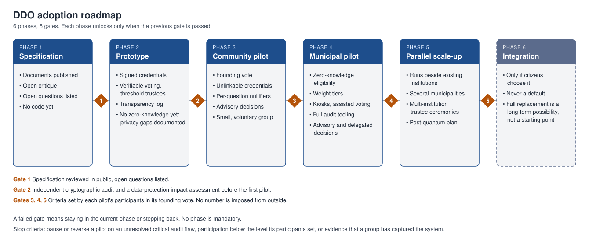

# DDO — Direct Decentralized Organization

### A Whitepaper for Merit-Based, Non-Hierarchical, Direct Democracy

by **albste** · Oct 16, 2026 · Version 0.1 · License: CC BY-SA 4.0

## Abstract

DDO (Direct Decentralized Organization) is a proposal for a political system in which citizens decide directly, power is spread across the whole population instead of stacked in a hierarchy, and influence on a question grows with proven competence and involvement in that specific domain. Every citizen starts with the same baseline weight; extra weight is earned per domain, capped, and never bought or inherited. Representatives and public staff exist to mediate, execute and verify, never to decide. Identity, voting and state records rely on self-sovereign identity, zero-knowledge proofs, verifiable voting and distributed ledgers, so that the right to vote can be proven without exposing who a person is, and every result can be audited by anyone. A Charter of Fundamental Rights, outside ordinary majority votes, protects minorities. This paper describes the model, its safeguards, its known weaknesses and a staged path from small pilots to wider adoption. It is published openly so that anyone can criticize, test and improve it.

## 1. Introduction and Problem Statement

Most political systems in use today share a structural design: citizens vote rarely, for people and packages rather than for decisions, and then delegate almost all power to a small group for years. This design was a reasonable answer to a world of paper ballots and slow communication. It produces recurring problems that are not caused by bad individuals but by the architecture itself.

- **Representation gap.** A voter chooses one bundle of positions every few years, so no one is represented on each issue separately.
- **Concentrated power.** Decisions are taken by few people, which makes them a target for lobbying, corruption and capture.
- **Weak accountability.** Mandates are hard to revoke, and promises carry little consequence between elections.
- **Low and uneven participation.** Citizens with the least time or information are the least heard, and many disengage entirely.
- **Opacity.** Citizens cannot easily verify how decisions were reached or how public records were handled.
- **Competence mismatch.** Decisions on technical matters are made by generalists, or by whoever is closest to power, rather than by those who know the subject best.

Three technologies now make a different design thinkable: digital identity that works without a central database of people, cryptographic proofs that confirm a right without revealing a person, and distributed ledgers that let anyone audit a record. DDO is an attempt to combine them with a clear set of democratic principles.

DDO does not claim to be a finished or perfect system. It claims to be a coherent starting point that is concrete enough to be tested, attacked and improved in public.

## 2. Core Principles

DDO rests on nine principles. Every rule in the rest of this paper should be traceable to one of them.

1. **Decentralized, non-hierarchical power.** No person or body holds standing authority over others. Authority exists only as the outcome of a vote, for a defined scope and time.
2. **Equal baseline citizenship.** Every citizen in good standing has the same baseline voice. Nobody is more of a citizen than anybody else.
3. **Merit as contextual weight.** On a given question, additional weight may be earned through verified competence and involvement in that domain, within a fixed cap. Merit never grants permanent status.
4. **Mediators, not rulers.** Representatives and public staff have no decision power of their own. They collect problems, structure proposals, and put them to the citizens affected.
5. **Rules before laws.** The conditions for voting on any law (who is eligible, what thresholds apply, how long votes run) are themselves decided by citizens before that law is proposed.
6. **Everything is revisable, at a measured pace.** Any law can be reopened, including DDO itself, but each law has a lock period that prevents endless churn.
7. **A constitutional floor.** A Charter of Fundamental Rights protects people from majority decisions and is amended only by a stricter procedure.
8. **Verifiability with privacy.** Anyone can check that the system ran correctly; nobody can be forced to reveal how they voted or who they are beyond what a vote requires.
9. **Open by design.** Specifications, code and records are public and forkable, so the system can be inspected and corrected by anyone.

## 3. System Overview

In DDO, every decision follows the same lifecycle, and every parameter of that lifecycle is itself set by citizens.

1. **Proposal.** Any citizen can propose an idea in any field of social life, without discrimination.
2. **Support threshold.** The proposal goes to a vote only after it gathers a minimum level of support. The threshold depends on the type of law.
3. **Eligibility.** Only citizens who meet the voting conditions fixed in advance for that law can vote.
4. **Voting window.** Each law has a voting period fixed before voting opens. Results are counted only when it closes.
5. **Tally and publication.** The result and the evidence needed to verify it are published.
6. **Lock period.** The approved law cannot be re-voted or modified until its lock period ends. Citizens vote on the length of that period too.

Three types of law exist, differing in who may vote:

| Type | Who votes | Typical use |
| --- | --- | --- |
| Niche | Only citizens who meet defined characteristics (competence, profession, role) | Technical or sector-specific rules |
| Territorial | Only residents of a given place or district | Local matters such as urban planning or local services |
| Referendum | All adult citizens in good standing | Questions that affect everyone |

Anyone can submit a proposal, but only eligible citizens can endorse or approve it. Proposing is open; deciding is scoped to those most concerned or most qualified, by rules that all citizens set.

## 4. The Weighted Voting Model

Every eligible citizen has the same baseline weight. On a given law, a citizen can earn extra weight only from competence and involvement relevant to that law's domain, and that extra weight is capped.

```latex
W_i(d) = 1 + \min\bigl(S_i(d),\ C\bigr)
```

Here W is the weight of citizen i on a law in domain d, S is that citizen's domain score, and C is the cap. The cap C is decided in the bootstrapping phase and can be changed only by a citizen vote. As a starting proposal for pilots, C = 1, so no citizen's weight exceeds twice the baseline on any law; each community may vote a different value.

Two citizens with the same education, credentials and verified contributions in a domain get the same weight there. A citizen with different roles, work or social commitments gets a different weight, because those differences are relevant to that domain. A farmer and a surgeon have the same baseline weight everywhere, and different extra weight on agricultural policy and on surgical standards.

**What can raise a domain score**

- Verified credentials (degrees, licences, certifications) issued by recognized bodies as verifiable credentials.
- Verified work or social roles in the domain.
- Constructive participation on the platform, such as well-received proposals and sound mediation. This is the "activism paid in points" of the original DDO notes.

**Safeguards against a new elite**

- **Cap.** The extra weight has a ceiling, so expertise can inform a vote but never replace the baseline voice of everyone else.
- **Domain scope.** Scores apply only to their domain. A high score in one field gives nothing in another.
- **Non-transferable and non-purchasable.** Scores cannot be sold, delegated or inherited.
- **Decay.** Scores fade without continued, verified activity, so past merit does not become permanent privilege.
- **Aggregate limit.** No single group may hold more than a set share of the total weight in any vote.
- **Rules voted first.** The scoring rules and the eligibility conditions of every law are approved by citizens before that law is proposed.
- **Public audit.** The scoring rules are public, and anyone can check that a score was computed according to them.

The Charter of Fundamental Rights and decisions on the scoring system itself are never subject to weighted voting. They use one citizen, one equal vote.

## 5. Roles: Mediators and Operators

DDO keeps two public roles. Neither holds decision power.

**Mediators (representatives).** When a problem arises in a municipality or region, a mediator collects it, frames it as a clear proposal and puts it on the platform for a vote by the citizens it affects. A mediator never settles the matter alone. Mediators are elected only by the citizens they represent, or directly by eligible citizens on the basis of curriculum and political score.

**Operators (system staff).** Operators keep the system running: they maintain security, build and maintain voting kiosks and identity tools, validate documents and credentials, and update scores according to the public rules. Citizens with the required qualifications and scores can apply.

**Rules common to both roles**

- Both are elected periodically, and candidacy requires meeting scores, characteristics or skills voted in advance.
- Contracts have a fixed term. A person can serve again only if they stand again and are re-elected.
- Every action taken in the role is logged in a public record.
- Anyone found abusing their position is removed from the role.
- Repeated abuse leads to suspension from the platform.

Because these roles carry no discretionary power, the risk they pose is bounded: the worst a corrupt mediator or operator can do is to delay, misreport or misframe. Each of these is detectable, because every step is public and verifiable, and each leads to removal.

## 6. Identity, Privacy and Security

A direct system needs strong answers to four questions: is this a real, unique person; are they eligible for this vote; was their vote counted as cast; and can anyone be pressured or paid to vote a certain way. DDO answers them with the following design. Implementation details are in the companion technical document.

**Identity without a central file on people.** Each citizen holds a digital identity wallet under their own control, based on self-sovereign identity standards and compatible with national digital identity schemes such as the European eIDAS 2.0 wallet. Biometrics, where used, only unlock the wallet on the citizen's own device. They are not stored in a central register. Enrolment is checked by operators against an existing official identity, with the right to appeal.

**Proving eligibility without revealing identity.** Eligibility is expressed as verifiable credentials (age, residence, qualification, role). Zero-knowledge proofs let a citizen show that they meet the conditions of a given vote, for example "adult resident of this district with a domain score above the required level", without revealing who they are or anything else.

**One person, one vote.** A cryptographic mechanism ensures that each eligible person can cast only one counted vote per question, without linking that vote to their identity.

**Verifiable counting.** Votes are recorded in a public, append-only ledger. Cryptographic receipts let each voter check that their vote was recorded as cast, and let anyone check that the tally matches the recorded votes, without revealing individual choices.

**Coercion and vote buying.** Remote voting can never fully remove this risk, so DDO combines several mitigations: voters can re-cast their vote until the window closes, with the last vote counting; receipts do not prove how a person voted; and private voting booths in every municipality offer a coercion-resistant option.

**Fake identities.** Enrolment against official identity, one credential per person per issuer, and revocation of fraudulent credentials limit this attack. It remains one of the main attack surfaces and is addressed in the risk section.

**Access for everyone.** Voting must work on ordinary phones and computers, on public kiosks in every municipality, and with assisted voting for people with disabilities or without digital skills. Nobody loses their vote for lack of a device.

**Access to personal data.** Authorities, including police, may obtain a citizen's data only through the minimum disclosure needed for the case, under a recorded legal basis, with every access visible to the citizen and in the public audit log. Unauthorized access is itself an abuse of position and is handled as such.

## 7. Protecting Minorities: the Charter of Fundamental Rights

Direct democracy without limits can let a majority vote away the rights of a minority. DDO therefore keeps a small Charter of Fundamental Rights, published as a separate document, which no ordinary vote can override. It covers matters such as equal dignity and non-discrimination, freedom of conscience and expression, privacy and protection from surveillance, due process, and the integrity of the voting system itself.

The Charter is not frozen forever, which would contradict the principle that everything is revisable. Changing it requires a stricter procedure than an ordinary law:

- Equal weight for every eligible citizen, with no domain scores.
- A supermajority set in the bootstrapping phase, and a quorum of participation.
- Two votes separated by a long, fixed delay.
- No change may remove the procedure for changing the Charter itself without the same procedure.

Any ordinary law that conflicts with the Charter is void, and a transparent review process lets any citizen challenge a law on those grounds.

## 8. Bootstrapping Phase

DDO needs a first set of rules before it can run, and those rules cannot come from the system itself. The bootstrapping phase solves this circularity: the first rules are set by a founding vote in which all adult citizens in good standing of the participating community take part, with equal weight, no domain scores and simple majority with a quorum.

The founding vote decides:

- the general voting conditions and who counts as a citizen in good standing;
- the support threshold for each type of law;
- the scoring rules, the weight cap and the decay of scores;
- the voting window and the lock period for each type of law;
- the minimum requirements for candidacy as mediator or operator;
- the supermajority and delays needed to amend the Charter;
- the aggregate limit on any group's share of weight.

These choices are deliberately left open in this paper. Fixing numbers in advance would put the author, not the citizens, in charge of the parameters that matter most. Each pilot community runs its own founding vote, and the results of different pilots are published and compared.

## 9. Adoption Roadmap

Full replacement of existing governments is a long-term possibility, not a starting point. DDO should grow through six phases, each unlocked only when the previous one meets its gate.



The gate criteria are set by the participants of each pilot in its founding vote, so no number is imposed from outside. A failed gate means the community stays in the current phase or steps back; no phase is mandatory, and the last one happens only if citizens choose it.

## 10. Risks, Limitations and Open Questions

DDO does not remove politics; it moves it. The main risks below are real, and the mitigations are proposals to be tested, not guarantees. This paper does not claim DDO is 100% feasible on paper. It declares risks, limits and open questions instead, which is more credible for a public document. The weakest point is weighted voting with strong privacy, which is still an open research problem.

| Risk | Why it matters | Proposed mitigation |
| --- | --- | --- |
| Decision fatigue | Too many votes exhaust citizens and favour those with the most time | Support thresholds, mediators who bundle and filter, relevance scoping so people only vote where affected |
| Digital divide | People without devices or skills are excluded | Public kiosks, assisted voting, offline enrolment, accessible design |
| Score gaming | Points could be farmed or manipulated | Verified sources only, decay, caps, public scoring rules, audits |
| Technocracy drift | Expert weight could harden into a new elite | Cap, domain scope, aggregate limit, equal weight on the Charter and scoring rules |
| Fake identities | One person could vote many times | Official-identity enrolment, one credential per person per issuer, revocation |
| Coercion and vote buying | Pressure on voters undermines free choice | Re-voting, receipt-free design, private booths |
| Majority tyranny | Majorities can target minorities | Charter of Fundamental Rights with stricter amendment rules |
| Populism and manipulation | Fast votes can be swayed by misinformation | Mandatory deliberation period before each vote, public evidence, lock periods |
| Legal compatibility | Existing constitutions may not allow binding votes of this kind | Start with advisory and delegated decisions, and work with existing law |
| Software and key failures | Bugs or lost keys can break trust | Open code, independent audits, social key recovery, fallback procedures |

**Open questions.** Several questions cannot be answered on paper and need pilots and public debate:

- How should domains be defined and who may create new ones?
- How much extra weight is acceptable before the system stops feeling fair?
- How can deliberation be built into a fast online process without making it exclusive?
- How should a pilot handle people who refuse to take part?
- What should happen when two valid laws, from different domains, conflict?

**Stop criteria.** A pilot should be paused or reversed if an audit finds an unresolved critical flaw, if participation falls below the level its participants set, or if there is evidence that a group has captured the system.

## 11. How to Contribute and License

DDO is an open proposal, not a finished product. Criticism is as valuable as support. Useful contributions include:

- finding flaws in the model, the incentives or the security assumptions;
- proposing alternatives to any mechanism, with reasons;
- testing parts of the model in simulations, small groups or organizations;
- reviewing the legal fit with specific constitutions and jurisdictions;
- translating, clarifying and improving the documents.

**License.** This document is released under [Creative Commons Attribution-ShareAlike 4.0 International (CC BY-SA 4.0)](https://creativecommons.org/licenses/by-sa/4.0/). Anyone may copy, share, adapt and build on it, including commercially, provided that they credit the original author, **albste**, indicate any changes, and release derivative works under the same license.

The original idea and the first version of this text are credited to **albste**. Improvements belong to the community that makes them, under the same open terms.
