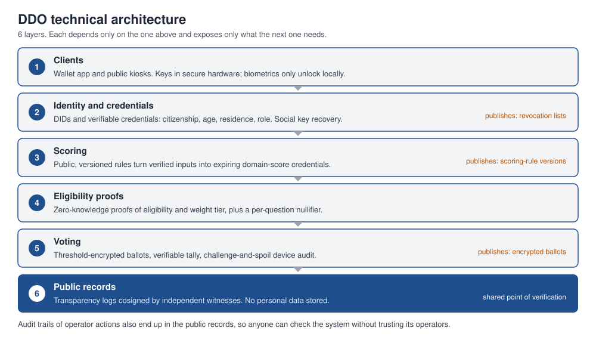

# DDO Technical Specification

### Draft stack for identity, eligibility, voting and public records

by **albste** · Oct 17, 2026 · Version 0.1 · License: CC BY-SA 4.0

Companion to the DDO Whitepaper. This is a design proposal, not a security-reviewed system. It does not claim to be 100% feasible on paper: it declares risks, limits and open questions instead, which is more credible for a public document. The weakest point is weighted voting with strong privacy, which is still an open research problem. Nothing here should be used for binding elections before independent cryptographic review and audit. Standards named below are evolving: verify their current status before implementing.

## 1. Goals and threat model

The stack must deliver five properties at once.

- **Eligibility:** only people entitled to vote on a given question can vote.
- **Uniqueness:** one counted vote per person per question.
- **Ballot secrecy:** nobody, including operators, can link a vote to a person.
- **Verifiability:** every voter can check their own vote, and anyone can check the tally.
- **Resilience:** the system survives malicious operators, compromised devices, outages and coercion attempts as far as technology can.

Adversaries considered: external attackers, malicious or coerced operators and trustees, voters selling or being forced to reveal votes, malware on voter devices, identity fraud, and well-funded state-level actors. Misinformation is a social problem and is addressed in the whitepaper, not here.

## 2. Design decisions at a glance

Every choice from the original DDO notes was re-examined. Several changed.

| Question | Original idea | Recommended | Why |
| --- | --- | --- | --- |
| Ledger | Blockchain for all state data | Append-only transparency logs with independent witnesses; optional anchoring on a public chain | Public chains leak metadata, cost fees, and cannot hold personal data; logs give the same audit property |
| Identity | Registered fingerprints and photos in a state database | Self-sovereign wallet, official-ID enrolment, biometrics only on the device | Central biometric databases are the largest privacy and security risk in the design |
| Eligibility | Operators check data when voting | Zero-knowledge proofs over verifiable credentials | Proves a right without revealing a person |
| Voting | Online platform and kiosks | End-to-end verifiable voting with threshold-encrypted ballots | Secret and publicly auditable |
| Scores | Points kept on the platform | Credentials with deterministic public rules and expiry | Auditable, non-transferable, decaying |
| Data access by authorities | Fingerprint retrieval at any office | Minimal disclosure through the citizen's wallet, logged | Avoids a universal lookup tool |

## 3. Public records: do we need a blockchain?

The whitepaper's requirement is that anyone can verify that records were not changed. That is an append-only, publicly auditable log. A blockchain is one way to get it, with real costs.

**Public permissionless chains** give strong censorship resistance but add fees, variable throughput, public metadata, dependence on token economics and, for personal data, conflict with data-protection rights such as erasure. They are a poor home for ballots.

**Permissioned BFT chains** run by a consortium (for example municipalities, universities, civil-society groups) give higher throughput and clear governance, but concentrate trust in the consortium.

**Transparency logs** (Merkle-tree logs in the style of Certificate Transparency, with independent witnesses cosigning checkpoints) give tamper evidence, cheap verification and horizontal scaling, without consensus overhead.

**Recommendation:** use transparency logs as the primary bulletin board for ballots, credential revocation lists, scoring-rule versions and audit trails, replicated by independent witnesses. Periodically publish log checkpoints to a public chain as a timestamp anchor. Never store personal data on any ledger; store only commitments, hashes and encrypted ballots. A permissioned BFT chain is a fallback if a pilot needs automatic multi-party agreement on shared state.

## 4. Identity and credentials

**Wallet.** Each citizen holds a wallet app, compatible with the EU digital identity wallet (eIDAS 2.0) where available, using W3C Decentralized Identifiers and Verifiable Credentials, with credential exchange following OpenID for Verifiable Credentials profiles. Keys live in secure hardware on the device (secure enclave or equivalent). Biometrics only unlock the key locally.

**Enrolment.** The citizen proves identity once, against an existing official identity (national eID, passport, in-person check). An operator-run issuer then issues a citizenship credential. The issuer sees the identity at that moment and keeps nothing that links the credential to later votes.

**Credential types.** Citizenship and age, residence (district), qualification, role, and domain score. Each credential has an issuer, an expiry and a revocation status.

**Recovery.** Lost devices are recovered through social recovery (a set of trusted contacts or institutions holding key shares) or through in-person re-issuance. No central key escrow.

## 5. Eligibility proofs and one-person-one-vote

To vote, the wallet proves, without revealing identity, that its holder meets the conditions of that specific question, and produces a per-question tag so the same person cannot vote twice.

- **Selective disclosure and unlinkability:** signature schemes that support unlinkable selective disclosure (BBS-style signatures) for simple attribute checks.
- **Set membership and range statements:** zero-knowledge proofs that the holder is in the eligible set and that a domain score meets a threshold, with weight tier derived from the score.
- **Per-question nullifier:** a deterministic tag derived from the holder's secret and the question identifier. It is unique per person per question and unlinkable across questions.
- **Proving system:** prefer systems with transparent setup (hash-based or similar), avoiding a trusted ceremony. Pairing-based systems are faster but depend on a setup and are not post-quantum.

## 6. The voting protocol

DDO needs end-to-end verifiability: individual verifiability (my vote was recorded as cast), universal verifiability (the tally is correct) and ballot secrecy.

**Candidate building blocks.** Existing open-source systems such as ElectionGuard, Belenios, Helios and the Swiss Post e-voting system implement variations of this. The recommendation is to build on a reviewed design rather than invent a protocol.

**Proposed design.**

1. Ballots are encrypted to a threshold key held by independent trustees (for example k of n institutions). No single party can decrypt.
2. The wallet attaches the eligibility proof and nullifier, then posts the encrypted ballot to the transparency log.
3. The voter can audit the device with a challenge-and-spoil step, so a compromised app is detectable.
4. Tallying uses homomorphic aggregation, or a verifiable shuffle, followed by threshold decryption with a proof of correct decryption.
5. The log publishes everything needed for anyone to recompute and check the result.

**Weighted votes.** Weight must be applied without revealing a voter's individual score. The ballot proves in zero knowledge that its weight belongs to one of a small set of discrete tiers consistent with the voter's credential and the cap. Using few tiers limits fingerprinting. This part has the least off-the-shelf support and is a priority research item.

**Coercion resistance.** Fully coercion-resistant remote voting schemes exist in the research literature but are costly at national scale. The practical mitigation is a combination of: revoting until the window closes (last vote counts), receipt-free design, and private kiosks where the voter votes unobserved. This reduces coercion risk; it does not eliminate it, and the paper should say so.

## 7. Scoring system

Scores are computed from verified inputs by public, versioned rules. Inputs are credentials from recognized issuers and logged participation events. The output is a domain score credential with an expiry, so decay is automatic. Rule versions live on the transparency log, and anyone can recompute a score from its inputs. Scores are bound to a holder's key and cannot be transferred. The system exposes only weight tiers during voting, never raw scores.

## 8. Architecture

Each layer depends only on the one above it and exposes only what the next layer needs. The public records layer is the shared point of verification: ballots, revocation lists, scoring-rule versions and audit trails all end up there, so anyone can check the system without trusting its operators.

## 9. Kiosks and offline access

Kiosks are open-hardware or open-firmware devices with secure boot and a minimal operating system. They run the same voting client, support assistive technology, and print an optional paper verification record that the voter can deposit for audit sampling. Offline enrolment and assisted voting are part of the baseline, in line with Article 9 of the Charter.

## 10. Data protection

- No personal data on any ledger or log.
- Off-chain data minimized, encrypted at rest, and deleted when no longer needed.
- Issuers hold only what enrolment requires, for the shortest time.
- Every access by an operator or authority is logged and visible to the data subject.
- A data-protection impact assessment is required before every pilot.

## 11. Security analysis

| Threat | Mitigation |
| --- | --- |
| Fake identities | Official-ID enrolment, revocation, one credential per person per issuer, audits of issuers |
| Malware on voter device | Challenge-and-spoil audit, kiosks, open-source reproducible builds |
| Coercion and vote selling | Revoting, receipt-free design, private kiosks |
| Malicious operators | Operators hold no decryption keys, all actions on the public log, threshold trustees from different institutions |
| Trustee compromise | k-of-n threshold keys with independent organizations, key ceremonies recorded and observable |
| Denial of service | Long voting windows, redundant endpoints, offline kiosks |
| Log tampering | Independent witnesses, public checkpoints, external anchoring |
| Key loss | Social recovery, in-person re-issuance |
| Supply-chain attacks | Reproducible builds, signed releases, multiple independent implementations |
| Quantum computers | Crypto-agility, hash-based proofs, migration plan to post-quantum signatures and key exchange |

## 12. Recommended implementation stack

- **Core cryptography and services:** Rust, for memory safety and a strong cryptography ecosystem.
- **Wallet and web clients:** TypeScript with a mobile wrapper, reusing audited libraries; native secure-hardware APIs for keys.
- **Credentials:** W3C Verifiable Credentials with selective-disclosure formats, and BBS-style signatures for unlinkable proofs.
- **Zero-knowledge proofs:** a transparent-setup proving system, chosen after benchmarking real circuits for eligibility and weight tiers.
- **Voting:** adapt an existing reviewed end-to-end verifiable design rather than writing a new one.
- **Public records:** transparency-log software with independent witnesses; optional public-chain anchoring.
- **Off-chain storage:** a conventional encrypted database, because it is the simplest choice that meets the requirements.
- **Process:** specifications first, formal verification of the core protocol where feasible, public bug bounty, independent audits before each pilot phase.

## 13. Build order aligned with the roadmap

1. **Specification and prototype:** signed credentials, simple eligibility checks, verifiable voting with threshold trustees and a transparency log. No zero-knowledge yet; document the privacy gaps.
2. **Community pilot:** add unlinkable credentials and per-question nullifiers; run the first founding votes.
3. **Municipal pilot:** add zero-knowledge eligibility and weight tiers, kiosks and assisted voting, full audit tooling.
4. **Scale-up:** multi-party trustee ceremonies across institutions, crypto-agility and post-quantum migration plan.

## 14. Open research problems

- Weighted ballots with strong privacy and low fingerprinting risk.
- Practical coercion resistance for remote voting at scale.
- Usable social recovery that does not become a new attack path.
- Sybil-resistant enrolment for people without official identity documents.
- Governance of trustees and witnesses: who they are, and how they are replaced.
- Formal modelling of the scoring system against gaming.

## License

Released under [Creative Commons Attribution-ShareAlike 4.0 International (CC BY-SA 4.0)](https://creativecommons.org/licenses/by-sa/4.0/). Credit the original author, **albste**, indicate changes, and share derivative works under the same license.
