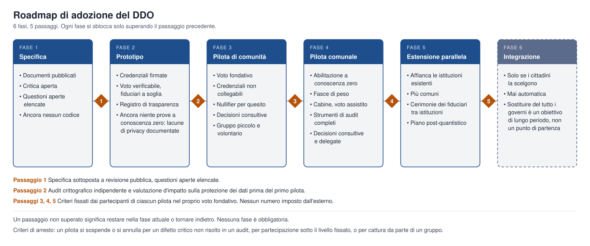

# DDO — Organizzazione Decentralizzata Diretta

### Un whitepaper per una democrazia diretta, meritocratica e non gerarchica

di **albste** · 16 ott 2026 · Versione 0.1 · Licenza: CC BY-SA 4.0

*Traduzione italiana del whitepaper originale in inglese.*

## Abstract

DDO (Direct Decentralized Organization, Organizzazione Decentralizzata Diretta) è una proposta di sistema politico in cui i cittadini decidono direttamente, il potere è distribuito su tutta la popolazione invece di essere impilato in una gerarchia, e l'influenza su una questione cresce con la competenza e il coinvolgimento dimostrati in quello specifico ambito. Ogni cittadino parte con lo stesso peso di base; il peso aggiuntivo si guadagna per ambito, è limitato da un tetto e non si compra né si eredita. Rappresentanti e personale pubblico esistono per mediare, eseguire e verificare, mai per decidere. Identità, voto e registri statali si basano su identità auto-sovrana, prove a conoscenza zero, voto verificabile e registri distribuiti, così che il diritto di voto si possa dimostrare senza rivelare chi è una persona e ogni risultato possa essere verificato da chiunque. Una Carta dei Diritti Fondamentali, esterna alle votazioni a maggioranza ordinarie, protegge le minoranze. Questo documento descrive il modello, le sue garanzie, i suoi punti deboli noti e un percorso graduale dai piccoli piloti a un'adozione più ampia. È pubblicato apertamente perché chiunque possa criticarlo, metterlo alla prova e migliorarlo.

## 1. Introduzione e definizione del problema

La maggior parte dei sistemi politici in uso condivide un'impostazione strutturale: i cittadini votano raramente, per persone e pacchetti di programmi anziché per singole decisioni, e poi delegano quasi tutto il potere a un piccolo gruppo per anni. Questa impostazione era una risposta ragionevole a un mondo di schede cartacee e comunicazioni lente. Produce però problemi ricorrenti, che non dipendono da singoli individui scorretti ma dall'architettura stessa.

- **Divario di rappresentanza.** L'elettore sceglie un insieme di posizioni ogni pochi anni, quindi nessuno è rappresentato su ogni singola questione.
- **Potere concentrato.** Le decisioni sono prese da pochi, e questo le rende bersaglio di lobby, corruzione e cattura.
- **Responsabilità debole.** I mandati sono difficili da revocare e le promesse hanno poche conseguenze tra un'elezione e l'altra.
- **Partecipazione bassa e disomogenea.** I cittadini con meno tempo o informazioni sono i meno ascoltati e molti si disinteressano del tutto.
- **Opacità.** I cittadini non riescono a verificare facilmente come si è giunti a una decisione o come sono stati gestiti i registri pubblici.
- **Scarto di competenza.** Le decisioni su temi tecnici sono prese da generalisti, o da chi è più vicino al potere, anziché da chi conosce meglio la materia.

Tre tecnologie rendono oggi pensabile un'impostazione diversa: un'identità digitale che funziona senza un archivio centrale delle persone, prove crittografiche che confermano un diritto senza rivelare la persona, e registri distribuiti che permettono a chiunque di verificare un dato. DDO è un tentativo di combinarle con un insieme chiaro di principi democratici.

DDO non pretende di essere un sistema finito o perfetto. Pretende di essere un punto di partenza coerente, abbastanza concreto da essere messo alla prova, attaccato e migliorato in pubblico.

## 2. Principi fondamentali

DDO poggia su nove principi. Ogni regola del resto del documento dovrebbe poter essere ricondotta a uno di essi.

1. **Potere decentralizzato e non gerarchico.** Nessuna persona o organo ha un'autorità stabile sugli altri. L'autorità esiste solo come esito di un voto, per un ambito e un tempo definiti.
2. **Cittadinanza di base uguale.** Ogni cittadino in regola ha la stessa voce di base. Nessuno è più cittadino di un altro.
3. **Il merito come peso contestuale.** Su una data questione si può guadagnare peso aggiuntivo grazie a competenza e coinvolgimento verificati in quell'ambito, entro un tetto fisso. Il merito non dà mai uno status permanente.
4. **Mediatori, non governanti.** Rappresentanti e personale pubblico non hanno potere decisionale proprio. Raccolgono i problemi, strutturano le proposte e le sottopongono ai cittadini interessati.
5. **Prima le regole, poi le leggi.** Le condizioni per votare qualsiasi legge (chi può votare, quali soglie valgono, quanto durano le votazioni) sono decise dai cittadini prima che la legge sia proposta.
6. **Tutto è rivedibile, con un ritmo misurato.** Qualsiasi legge può essere riaperta, compreso il DDO stesso, ma ogni legge ha un periodo di blocco che evita modifiche senza fine.
7. **Un pavimento costituzionale.** Una Carta dei Diritti Fondamentali protegge le persone dalle decisioni della maggioranza e si modifica solo con una procedura più rigida.
8. **Verificabilità con privacy.** Chiunque può controllare che il sistema abbia funzionato correttamente; nessuno può essere costretto a rivelare come ha votato o chi è, oltre a quanto un voto richiede.
9. **Aperto per progetto.** Specifiche, codice e registri sono pubblici e replicabili, così che chiunque possa ispezionare e correggere il sistema.

## 3. Panoramica del sistema

In DDO ogni decisione segue lo stesso ciclo, e ogni parametro di quel ciclo è a sua volta stabilito dai cittadini.

1. **Proposta.** Qualsiasi cittadino può proporre un'idea in qualsiasi campo della vita sociale, senza discriminazioni.
2. **Soglia di sostegno.** La proposta va al voto solo dopo aver raccolto un livello minimo di consenso. La soglia dipende dal tipo di legge.
3. **Abilitazione.** Possono votare solo i cittadini che rispettano le condizioni di voto fissate in anticipo per quella legge.
4. **Finestra di voto.** Ogni legge ha un periodo di votazione fissato prima che il voto si apra. I risultati vengono conteggiati solo alla chiusura.
5. **Spoglio e pubblicazione.** Il risultato e le prove necessarie per verificarlo vengono pubblicati.
6. **Periodo di blocco.** La legge approvata non può essere rivotata o modificata finché non termina il suo periodo di blocco. Anche la durata di tale periodo è votata dai cittadini.

Esistono tre tipi di legge, che differiscono per chi può votare:

| Tipo | Chi vota | Uso tipico |
| --- | --- | --- |
| Di nicchia | Solo i cittadini che rispettano caratteristiche definite (competenza, professione, ruolo) | Regole tecniche o di settore |
| Territoriale | Solo i residenti in un determinato luogo o circoscrizione | Questioni locali come urbanistica o servizi locali |
| Referendum | Tutti i cittadini maggiorenni in regola | Questioni che riguardano tutti |

Chiunque può presentare una proposta, ma solo i cittadini abilitati possono sostenerla o approvarla. Proporre è aperto a tutti; decidere è riservato a chi è più coinvolto o più qualificato, secondo regole stabilite da tutti i cittadini.

## 4. Il modello di voto ponderato

Ogni cittadino abilitato ha lo stesso peso di base. Su una data legge, un cittadino può guadagnare peso aggiuntivo solo da competenze e coinvolgimento rilevanti per l'ambito di quella legge, e tale peso aggiuntivo è limitato da un tetto.

```latex
W_i(d) = 1 + \min\bigl(S_i(d),\ C\bigr)
```

Qui W è il peso del cittadino i su una legge dell'ambito d, S è il punteggio di quel cittadino nell'ambito, e C è il tetto. Il tetto C è deciso nella fase di avviamento e può essere modificato solo con un voto dei cittadini. Come proposta di partenza per i piloti, C = 1: nessun cittadino supera il doppio del peso di base su una legge, e ogni comunità può votare un valore diverso.

Due cittadini con la stessa istruzione, gli stessi titoli e gli stessi contributi verificati in un ambito hanno lo stesso peso in quell'ambito. Un cittadino con ruoli, lavoro o impegni sociali diversi ha un peso diverso, perché quelle differenze sono rilevanti per quell'ambito. Un agricoltore e un chirurgo hanno lo stesso peso di base ovunque, e un peso aggiuntivo diverso sulla politica agricola e sugli standard chirurgici.

**Cosa può aumentare il punteggio di un ambito**

- Titoli verificati (lauree, abilitazioni, certificazioni) rilasciati da enti riconosciuti sotto forma di credenziali verificabili.
- Ruoli lavorativi o sociali verificati nell'ambito.
- Partecipazione costruttiva sulla piattaforma, come proposte ben accolte e una buona mediazione. È l'«attivismo pagato in punti» degli appunti originali del DDO.

**Garanzie contro una nuova élite**

- **Tetto.** Il peso aggiuntivo ha un limite massimo, così la competenza può orientare un voto ma non sostituire mai la voce di base di tutti gli altri.
- **Ambito specifico.** I punteggi valgono solo nel loro ambito. Un punteggio alto in un campo non dà nulla in un altro.
- **Non trasferibile e non acquistabile.** I punteggi non si possono vendere, delegare o ereditare.
- **Decadimento.** I punteggi si riducono senza attività continua e verificata, così il merito passato non diventa un privilegio permanente.
- **Limite aggregato.** Nessun singolo gruppo può detenere più di una certa quota del peso totale in una votazione.
- **Regole votate prima.** Le regole di punteggio e le condizioni di abilitazione di ogni legge sono approvate dai cittadini prima che la legge sia proposta.
- **Audit pubblico.** Le regole di punteggio sono pubbliche e chiunque può verificare che un punteggio sia stato calcolato secondo di esse.

La Carta dei Diritti Fondamentali e le decisioni sul sistema di punteggio non sono mai soggette a voto ponderato. Usano un cittadino, un voto uguale.

## 5. Ruoli: Mediatori e Operatori

DDO prevede due ruoli pubblici. Nessuno dei due ha potere decisionale.

**Mediatori (rappresentanti).** Quando in un comune o in una regione sorge un problema, il mediatore lo raccoglie, lo trasforma in una proposta chiara e lo mette sulla piattaforma per il voto dei cittadini che riguarda. Un mediatore non risolve mai la questione da solo. I mediatori sono eletti solo dai cittadini che rappresentano, oppure direttamente dai cittadini abilitati sulla base di curriculum e punteggio politico.

**Operatori (personale del sistema).** Gli operatori fanno funzionare il sistema: mantengono la sicurezza, costruiscono e mantengono cabine di voto e strumenti di identità, convalidano documenti e credenziali e aggiornano i punteggi secondo le regole pubbliche. Possono candidarsi i cittadini con le qualifiche e i punteggi richiesti.

**Regole comuni a entrambi i ruoli**

- Entrambi sono eletti periodicamente e la candidatura richiede di rispettare punteggi, caratteristiche o competenze votati in anticipo.
- I contratti hanno una scadenza. Una persona può prestare servizio di nuovo solo se si ricandida e viene rieletta.
- Ogni azione svolta nel ruolo viene registrata in un registro pubblico.
- Chiunque venga sorpreso ad abusare della propria posizione viene sollevato dall'incarico.
- L'abuso ripetuto comporta la sospensione dalla piattaforma.

Poiché questi ruoli non hanno potere discrezionale, il rischio che pongono è limitato: il peggio che un mediatore o un operatore corrotto possa fare è ritardare, riportare male o impostare male una questione. Ognuna di queste azioni è individuabile, perché ogni passaggio è pubblico e verificabile, e porta alla rimozione.

## 6. Identità, privacy e sicurezza

Un sistema diretto ha bisogno di risposte solide a quattro domande: si tratta di una persona reale e unica; ha diritto a questo voto; il suo voto è stato conteggiato come espresso; e si può fare pressione su qualcuno o pagarlo perché voti in un certo modo. DDO risponde con il seguente progetto. I dettagli implementativi sono nel documento tecnico di accompagnamento.

**Identità senza un archivio centrale delle persone.** Ogni cittadino possiede un portafoglio di identità digitale sotto il proprio controllo, basato su standard di identità auto-sovrana e compatibile con gli schemi nazionali di identità digitale come il portafoglio europeo eIDAS 2.0. I dati biometrici, quando usati, servono solo a sbloccare il portafoglio sul dispositivo del cittadino. Non sono conservati in un registro centrale. L'iscrizione è verificata dagli operatori rispetto a un'identità ufficiale esistente, con diritto di ricorso.

**Dimostrare l'abilitazione senza rivelare l'identità.** L'abilitazione è espressa come credenziali verificabili (età, residenza, titolo, ruolo). Le prove a conoscenza zero permettono al cittadino di dimostrare che rispetta le condizioni di un dato voto, ad esempio «residente maggiorenne di questo distretto con un punteggio di ambito superiore al livello richiesto», senza rivelare chi è né altro.

**Una persona, un voto.** Un meccanismo crittografico garantisce che ogni persona abilitata possa esprimere un solo voto conteggiato per quesito, senza collegare quel voto alla sua identità.

**Conteggio verificabile.** I voti sono registrati in un registro pubblico, a sola aggiunta. Ricevute crittografiche permettono a ogni elettore di verificare che il proprio voto sia stato registrato come espresso, e a chiunque di verificare che lo spoglio corrisponda ai voti registrati, senza rivelare le scelte individuali.

**Coercizione e compravendita dei voti.** Il voto a distanza non può mai eliminare del tutto questo rischio, quindi DDO combina diverse mitigazioni: gli elettori possono ripetere il voto fino alla chiusura della finestra, e conta l'ultimo; le ricevute non provano come una persona ha votato; e cabine di voto private in ogni comune offrono un'opzione resistente alla coercizione.

**Identità false.** Iscrizione verificata su un'identità ufficiale, una credenziale per persona per emittente e revoca delle credenziali fraudolente limitano questo attacco. Resta una delle principali superfici di attacco e viene trattata nella sezione sui rischi.

**Accesso per tutti.** Il voto deve funzionare su normali telefoni e computer, su cabine pubbliche in ogni comune e con voto assistito per persone con disabilità o senza competenze digitali. Nessuno perde il proprio voto per mancanza di un dispositivo.

**Accesso ai dati personali.** Le autorità, comprese le forze dell'ordine, possono ottenere i dati di un cittadino solo tramite la divulgazione minima necessaria al caso, con una base giuridica registrata, con ogni accesso visibile al cittadino e nel registro di audit pubblico. L'accesso non autorizzato è esso stesso un abuso di posizione e viene trattato come tale.

## 7. Tutela delle minoranze: la Carta dei Diritti Fondamentali

Una democrazia diretta senza limiti può permettere a una maggioranza di votare via i diritti di una minoranza. DDO mantiene quindi una breve Carta dei Diritti Fondamentali, pubblicata come documento separato, che nessun voto ordinario può scavalcare. Riguarda temi come pari dignità e non discriminazione, libertà di coscienza e di espressione, privacy e protezione dalla sorveglianza, giusto processo e integrità del sistema di voto stesso.

La Carta non è congelata per sempre, cosa che contraddirebbe il principio per cui tutto è rivedibile. Modificarla richiede una procedura più rigida di quella di una legge ordinaria:

- Peso uguale per ogni cittadino abilitato, senza punteggi di ambito.
- Una supermaggioranza stabilita nella fase di avviamento e un quorum di partecipazione.
- Due votazioni separate da un lungo ritardo fisso.
- Nessuna modifica può eliminare la procedura di modifica della Carta stessa senza seguire la stessa procedura.

Qualsiasi legge ordinaria in contrasto con la Carta è nulla, e un processo di revisione trasparente permette a ogni cittadino di contestare una legge per questo motivo.

## 8. Fase di avviamento

DDO ha bisogno di un primo insieme di regole prima di poter funzionare, e quelle regole non possono venire dal sistema stesso. La fase di avviamento risolve questa circolarità: le prime regole sono fissate da un voto fondativo a cui partecipano, con peso uguale, tutti i cittadini maggiorenni in regola della comunità partecipante, senza punteggi di ambito e a maggioranza semplice con quorum.

Il voto fondativo decide:

- le condizioni generali di voto e chi conta come cittadino in regola;
- la soglia di sostegno per ogni tipo di legge;
- le regole di punteggio, il tetto di peso e il decadimento dei punteggi;
- la finestra di voto e il periodo di blocco per ogni tipo di legge;
- i requisiti minimi di candidatura a mediatore o operatore;
- la supermaggioranza e i ritardi necessari per modificare la Carta;
- il limite aggregato alla quota di peso di qualsiasi gruppo.

Queste scelte sono lasciate volutamente aperte in questo documento. Fissare i numeri in anticipo metterebbe l'autore, e non i cittadini, a decidere i parametri più importanti. Ogni comunità pilota svolge il proprio voto fondativo e i risultati dei diversi piloti vengono pubblicati e confrontati.

## 9. Roadmap di adozione

La sostituzione integrale dei governi esistenti è una possibilità di lungo periodo, non un punto di partenza. Il DDO dovrebbe crescere in sei fasi, ognuna sbloccata solo quando la precedente supera il proprio passaggio.



I criteri di passaggio sono fissati dai partecipanti di ciascun pilota nel proprio voto fondativo, quindi nessun numero è imposto dall'esterno. Un passaggio non superato significa restare nella fase attuale o tornare indietro; nessuna fase è obbligatoria, e l'ultima avviene solo se i cittadini la scelgono.

## 10. Rischi, limiti e questioni aperte

DDO non elimina la politica: la sposta. I principali rischi qui sotto sono reali, e le mitigazioni sono proposte da mettere alla prova, non garanzie. Questo documento non dichiara il DDO fattibile al 100% sulla carta. Dichiara invece rischi, limiti e questioni aperte, che per un documento pubblico è più credibile. Il punto più debole è il voto ponderato con forte privacy, ancora un problema di ricerca.

| Rischio | Perché conta | Mitigazione proposta |
| --- | --- | --- |
| Affaticamento decisionale | Troppe votazioni stancano i cittadini e favoriscono chi ha più tempo | Soglie di sostegno, mediatori che raggruppano e filtrano, ambiti di rilevanza perché si voti solo dove si è coinvolti |
| Divario digitale | Chi non ha dispositivi o competenze resta escluso | Cabine pubbliche, voto assistito, iscrizione in presenza, design accessibile |
| Manipolazione dei punteggi | I punti potrebbero essere accumulati o manipolati | Solo fonti verificate, decadimento, tetti, regole di punteggio pubbliche, audit |
| Deriva tecnocratica | Il peso degli esperti potrebbe consolidarsi in una nuova élite | Tetto, ambito specifico, limite aggregato, peso uguale su Carta e regole di punteggio |
| Identità false | Una persona potrebbe votare più volte | Iscrizione su identità ufficiale, una credenziale per persona per emittente, revoca |
| Coercizione e compravendita di voti | Le pressioni sugli elettori minano la libertà di scelta | Nuovo voto, assenza di ricevute probatorie, cabine private |
| Tirannia della maggioranza | Le maggioranze possono colpire le minoranze | Carta dei Diritti Fondamentali con regole di modifica più rigide |
| Populismo e manipolazione | Votazioni rapide possono essere influenzate dalla disinformazione | Periodo di deliberazione obbligatorio prima di ogni voto, prove pubbliche, periodi di blocco |
| Compatibilità giuridica | Le costituzioni esistenti potrebbero non ammettere voti vincolanti di questo tipo | Partire da decisioni consultive e delegate e lavorare nel quadro del diritto vigente |
| Guasti di software e chiavi | Bug o chiavi perse possono incrinare la fiducia | Codice aperto, audit indipendenti, recupero sociale delle chiavi, procedure di emergenza |

**Questioni aperte.** Diverse domande non si risolvono sulla carta e richiedono piloti e dibattito pubblico:

- Come vanno definiti gli ambiti e chi può crearne di nuovi?
- Quanto peso aggiuntivo è accettabile prima che il sistema smetta di sembrare equo?
- Come integrare la deliberazione in un processo online veloce senza renderlo esclusivo?
- Come deve gestire un pilota chi rifiuta di partecipare?
- Cosa succede quando due leggi valide, di ambiti diversi, entrano in conflitto?

**Criteri di arresto.** Un pilota va sospeso o annullato se un audit rileva un difetto critico non risolto, se la partecipazione scende sotto il livello stabilito dai suoi partecipanti, o se emergono prove che un gruppo abbia catturato il sistema.

## 11. Come contribuire e licenza

DDO è una proposta aperta, non un prodotto finito. La critica ha lo stesso valore del sostegno. Contributi utili sono:

- individuare difetti nel modello, negli incentivi o nelle ipotesi di sicurezza;
- proporre alternative a qualsiasi meccanismo, motivandole;
- sperimentare parti del modello in simulazioni, piccoli gruppi o organizzazioni;
- verificare la compatibilità giuridica con specifiche costituzioni e giurisdizioni;
- tradurre, chiarire e migliorare i documenti.

**Licenza.** Questo documento è rilasciato con licenza [Creative Commons Attribuzione-Condividi allo stesso modo 4.0 Internazionale (CC BY-SA 4.0)](https://creativecommons.org/licenses/by-sa/4.0/deed.it). Chiunque può copiarlo, condividerlo, adattarlo e usarlo come base, anche a fini commerciali, purché citi l'autore originale, **albste**, indichi le modifiche apportate e rilasci le opere derivate con la stessa licenza.

L'idea originale e la prima versione di questo testo sono attribuite ad **albste**. I miglioramenti appartengono alla comunità che li realizza, alle stesse condizioni aperte.
