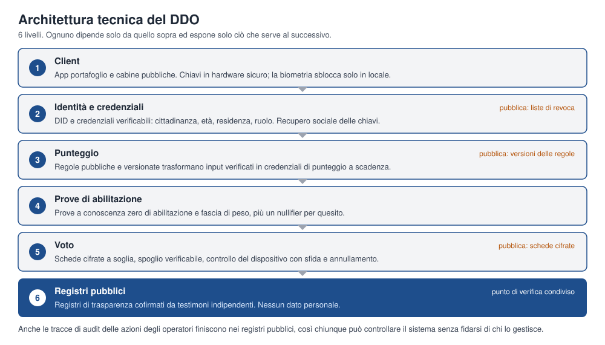

# Specifica Tecnica del DDO

### Bozza di stack per identità, abilitazione, voto e registri pubblici

di **albste** · 17 ott 2026 · Versione 0.1 · Licenza: CC BY-SA 4.0

Documento di accompagnamento al Whitepaper DDO. Traduzione italiana dell'originale in inglese. Questa è una proposta di progetto, non un sistema sottoposto a revisione di sicurezza. Non dichiara di essere fattibile al 100% sulla carta: dichiara invece rischi, limiti e questioni aperte, che per un documento pubblico è più credibile. Il punto più debole è il voto ponderato con forte privacy, ancora un problema di ricerca. Nulla di quanto segue va usato per elezioni vincolanti prima di una revisione crittografica indipendente e di audit. Gli standard citati sono in evoluzione: verificane lo stato attuale prima di implementarli.

## 1. Obiettivi e modello di minaccia

Lo stack deve garantire cinque proprietà insieme.

- **Abilitazione:** votano su una data questione solo le persone che ne hanno diritto.
- **Unicità:** un voto conteggiato per persona per quesito.
- **Segretezza del voto:** nessuno, operatori compresi, può collegare un voto a una persona.
- **Verificabilità:** ogni elettore può controllare il proprio voto e chiunque può controllare lo spoglio.
- **Resilienza:** il sistema resiste, per quanto la tecnologia consente, a operatori malevoli, dispositivi compromessi, interruzioni e tentativi di coercizione.

Avversari considerati: attaccanti esterni, operatori e fiduciari malevoli o costretti, elettori che vendono o sono obbligati a rivelare il voto, malware sui dispositivi degli elettori, frodi di identità e attori statali con grandi risorse. La disinformazione è un problema sociale e viene trattata nel whitepaper, non qui.

## 2. Le scelte di progetto in sintesi

Ogni scelta degli appunti originali del DDO è stata riesaminata. Diverse sono cambiate.

| Questione | Idea originale | Raccomandato | Perché |
| --- | --- | --- | --- |
| Registro | Blockchain per tutti i dati | Registri di trasparenza a sola aggiunta con testimoni indipendenti; ancoraggio opzionale su una catena pubblica | Le catene pubbliche espongono metadati, hanno costi e non possono contenere dati personali; i registri danno la stessa proprietà di verifica |
| Identità | Impronte e foto registrate in un database statale | Portafoglio auto-sovrano, iscrizione su identità ufficiale, biometria solo sul dispositivo | Un database biometrico centrale è il maggiore rischio di privacy e sicurezza del progetto |
| Abilitazione | Gli operatori controllano i dati al momento del voto | Prove a conoscenza zero su credenziali verificabili | Dimostra un diritto senza rivelare la persona |
| Voto | Piattaforma online e cabine | Voto verificabile end-to-end con schede cifrate a soglia | Segreto e verificabile pubblicamente |
| Punteggi | Punti conservati sulla piattaforma | Credenziali con regole pubbliche deterministiche e scadenza | Verificabili, non trasferibili, soggetti a decadimento |
| Accesso ai dati da parte delle autorità | Recupero tramite impronta in qualsiasi ufficio | Divulgazione minima tramite il portafoglio del cittadino, registrata | Evita uno strumento di ricerca universale |

## 3. Registri pubblici: serve una blockchain?

Il requisito del whitepaper è che chiunque possa verificare che i registri non siano stati alterati. Si tratta di un registro a sola aggiunta, verificabile pubblicamente. Una blockchain è un modo per ottenerlo, con costi reali.

**Catene pubbliche senza permessi** offrono una forte resistenza alla censura, ma aggiungono commissioni, capacità variabile, metadati pubblici, dipendenza dall'economia di un token e, per i dati personali, conflitto con diritti di protezione dei dati come la cancellazione. Sono una sede inadatta per le schede di voto.

**Catene con permessi e consenso BFT** gestite da un consorzio (ad esempio comuni, università, gruppi della società civile) danno maggiore capacità e una governance chiara, ma concentrano la fiducia nel consorzio.

**Registri di trasparenza** (registri ad albero di Merkle sul modello di Certificate Transparency, con testimoni indipendenti che cofirmano i punti di controllo) danno evidenza di manomissione, verifica economica e scalabilità orizzontale, senza il costo del consenso.

**Raccomandazione:** usare i registri di trasparenza come bacheca principale per schede, liste di revoca delle credenziali, versioni delle regole di punteggio e tracce di audit, replicati da testimoni indipendenti. Pubblicare periodicamente i punti di controllo su una catena pubblica come ancoraggio temporale. Non memorizzare mai dati personali su alcun registro; conservare solo impegni crittografici, hash e schede cifrate. Una catena BFT con permessi è un'alternativa se un pilota ha bisogno dell'accordo automatico tra più parti su uno stato condiviso.

## 4. Identità e credenziali

**Portafoglio.** Ogni cittadino possiede un'app portafoglio, compatibile con il portafoglio europeo di identità digitale (eIDAS 2.0) dove disponibile, basata su identificatori decentralizzati e credenziali verificabili del W3C, con scambio di credenziali secondo i profili OpenID per le credenziali verificabili. Le chiavi risiedono in hardware sicuro sul dispositivo (secure enclave o equivalente). La biometria sblocca la chiave solo in locale.

**Iscrizione.** Il cittadino dimostra l'identità una sola volta, rispetto a un'identità ufficiale esistente (eID nazionale, passaporto, verifica in presenza). Un emittente gestito dagli operatori rilascia poi una credenziale di cittadinanza. L'emittente vede l'identità in quel momento e non conserva nulla che colleghi la credenziale ai voti successivi.

**Tipi di credenziale.** Cittadinanza ed età, residenza (distretto), titolo, ruolo e punteggio di ambito. Ogni credenziale ha un emittente, una scadenza e uno stato di revoca.

**Recupero.** I dispositivi smarriti si recuperano tramite recupero sociale (un insieme di contatti o istituzioni fidati che detengono frammenti della chiave) o tramite riemissione in presenza. Nessun deposito centrale delle chiavi.

## 5. Prove di abilitazione e un voto per persona

Per votare, il portafoglio dimostra, senza rivelare l'identità, che il suo titolare soddisfa le condizioni di quello specifico quesito, e produce un'etichetta per quesito così che la stessa persona non possa votare due volte.

- **Divulgazione selettiva e non collegabilità:** schemi di firma che supportano la divulgazione selettiva non collegabile (firme in stile BBS) per i semplici controlli di attributo.
- **Appartenenza a un insieme e affermazioni su intervalli:** prove a conoscenza zero che il titolare appartiene all'insieme degli abilitati e che un punteggio di ambito raggiunge una soglia, con la fascia di peso derivata dal punteggio.
- **Nullifier per quesito:** un'etichetta deterministica derivata dal segreto del titolare e dall'identificativo del quesito. È unica per persona per quesito e non collegabile tra quesiti diversi.
- **Sistema di prova:** preferire sistemi con configurazione trasparente (basati su hash o simili), evitando una cerimonia di fiducia. I sistemi basati su accoppiamenti sono più veloci ma dipendono da una configurazione iniziale e non sono resistenti ai computer quantistici.

## 6. Il protocollo di voto

Il DDO richiede verificabilità end-to-end: verificabilità individuale (il mio voto è stato registrato come espresso), verificabilità universale (lo spoglio è corretto) e segretezza del voto.

**Elementi di base candidati.** Sistemi open source esistenti come ElectionGuard, Belenios, Helios e il sistema di voto elettronico di Swiss Post implementano varianti di questo schema. La raccomandazione è di basarsi su un progetto già sottoposto a revisione anziché inventare un protocollo.

**Progetto proposto.**

1. Le schede sono cifrate con una chiave a soglia detenuta da fiduciari indipendenti (ad esempio k istituzioni su n). Nessuna parte da sola può decifrare.
2. Il portafoglio allega la prova di abilitazione e il nullifier, poi pubblica la scheda cifrata sul registro di trasparenza.
3. L'elettore può controllare il dispositivo con un passaggio di sfida e annullamento, così un'app compromessa può essere individuata.
4. Lo spoglio usa l'aggregazione omomorfica, oppure un rimescolamento verificabile, seguito dalla decifratura a soglia con prova di corretta decifratura.
5. Il registro pubblica tutto ciò che serve a chiunque per ricalcolare e controllare il risultato.

**Voti ponderati.** Il peso deve essere applicato senza rivelare il punteggio individuale dell'elettore. La scheda dimostra a conoscenza zero che il suo peso appartiene a una di poche fasce discrete, coerenti con la credenziale dell'elettore e con il tetto. Usare poche fasce limita il rischio di identificazione. Questa parte è quella con meno supporto già pronto ed è una priorità di ricerca.

**Resistenza alla coercizione.** Schemi di voto a distanza pienamente resistenti alla coercizione esistono in letteratura ma sono costosi su scala nazionale. La mitigazione pratica combina: nuovo voto fino alla chiusura della finestra (conta l'ultimo), progetto senza ricevute probatorie e cabine private dove si vota senza essere osservati. Questo riduce il rischio di coercizione, non lo elimina, e il documento deve dirlo.

## 7. Sistema di punteggio

I punteggi sono calcolati da input verificati con regole pubbliche e versionate. Gli input sono credenziali di emittenti riconosciuti ed eventi di partecipazione registrati. L'output è una credenziale di punteggio di ambito con scadenza, così il decadimento è automatico. Le versioni delle regole stanno sul registro di trasparenza e chiunque può ricalcolare un punteggio dai suoi input. I punteggi sono legati alla chiave del titolare e non si possono trasferire. Durante il voto il sistema espone solo le fasce di peso, mai i punteggi grezzi.

## 8. Architettura

Ogni livello dipende solo da quello sopra e espone solo ciò che serve al successivo. Il livello dei registri pubblici è il punto di verifica condiviso: schede, liste di revoca, versioni delle regole di punteggio e tracce di audit finiscono tutte lì, così chiunque può controllare il sistema senza fidarsi dei suoi operatori.

## 9. Cabine e accesso fuori linea

Le cabine sono dispositivi con hardware o firmware aperto, avvio sicuro e un sistema operativo minimo. Eseguono lo stesso client di voto, supportano le tecnologie assistive e stampano una ricevuta cartacea di verifica opzionale che l'elettore può depositare per i controlli a campione. L'iscrizione fuori linea e il voto assistito fanno parte della base, in linea con l'Articolo 9 della Carta.

## 10. Protezione dei dati

- Nessun dato personale su alcun registro.
- Dati fuori registro ridotti al minimo, cifrati a riposo e cancellati quando non servono più.
- Gli emittenti conservano solo ciò che l'iscrizione richiede, per il tempo più breve.
- Ogni accesso di un operatore o di un'autorità è registrato e visibile all'interessato.
- Prima di ogni pilota è richiesta una valutazione d'impatto sulla protezione dei dati.

## 11. Analisi di sicurezza

| Minaccia | Mitigazione |
| --- | --- |
| Identità false | Iscrizione su identità ufficiale, revoca, una credenziale per persona per emittente, audit degli emittenti |
| Malware sul dispositivo dell'elettore | Controllo con sfida e annullamento, cabine, build riproducibili open source |
| Coercizione e compravendita di voti | Nuovo voto, progetto senza ricevute probatorie, cabine private |
| Operatori malevoli | Gli operatori non detengono chiavi di decifratura, tutte le azioni sul registro pubblico, fiduciari a soglia di istituzioni diverse |
| Compromissione dei fiduciari | Chiavi a soglia k su n con organizzazioni indipendenti, cerimonie delle chiavi registrate e osservabili |
| Negazione del servizio | Finestre di voto lunghe, punti di accesso ridondanti, cabine fuori linea |
| Manomissione del registro | Testimoni indipendenti, punti di controllo pubblici, ancoraggio esterno |
| Perdita delle chiavi | Recupero sociale, riemissione in presenza |
| Attacchi alla catena di fornitura | Build riproducibili, rilasci firmati, più implementazioni indipendenti |
| Computer quantistici | Agilità crittografica, prove basate su hash, piano di migrazione a firme e scambio di chiavi post-quantistici |

## 12. Stack di implementazione raccomandato

- **Crittografia e servizi di base:** Rust, per la sicurezza della memoria e un solido ecosistema crittografico.
- **Portafoglio e client web:** TypeScript con un involucro mobile, riutilizzando librerie verificate; API native di hardware sicuro per le chiavi.
- **Credenziali:** credenziali verificabili W3C con formati a divulgazione selettiva e firme in stile BBS per prove non collegabili.
- **Prove a conoscenza zero:** un sistema di prova a configurazione trasparente, scelto dopo aver misurato circuiti reali per abilitazione e fasce di peso.
- **Voto:** adattare un progetto end-to-end verificabile già esistente e revisionato, anziché scriverne uno nuovo.
- **Registri pubblici:** software per registri di trasparenza con testimoni indipendenti; ancoraggio opzionale su catena pubblica.
- **Archiviazione fuori registro:** un database convenzionale cifrato, perché è la scelta più semplice che soddisfa i requisiti.
- **Processo:** prima le specifiche, verifica formale del protocollo di base dove possibile, bug bounty pubblico, audit indipendenti prima di ogni fase pilota.

## 13. Ordine di sviluppo allineato alla roadmap

1. **Specifica e prototipo:** credenziali firmate, controlli di abilitazione semplici, voto verificabile con fiduciari a soglia e registro di trasparenza. Ancora senza conoscenza zero; documentare le lacune di privacy.
2. **Pilota di comunità:** aggiungere credenziali non collegabili e nullifier per quesito; svolgere i primi voti fondativi.
3. **Pilota comunale:** aggiungere abilitazione a conoscenza zero e fasce di peso, cabine e voto assistito, strumenti di audit completi.
4. **Estensione:** cerimonie multi-parte dei fiduciari tra istituzioni, agilità crittografica e piano di migrazione post-quantistica.

## 14. Problemi di ricerca aperti

- Schede ponderate con forte privacy e basso rischio di identificazione.
- Resistenza pratica alla coercizione per il voto a distanza su larga scala.
- Recupero sociale utilizzabile che non diventi un nuovo canale di attacco.
- Iscrizione resistente alle identità multiple per chi non ha documenti ufficiali.
- Governance di fiduciari e testimoni: chi sono e come vengono sostituiti.
- Modellazione formale del sistema di punteggio rispetto alla manipolazione.

## Licenza

Rilasciata con licenza [Creative Commons Attribuzione-Condividi allo stesso modo 4.0 Internazionale (CC BY-SA 4.0)](https://creativecommons.org/licenses/by-sa/4.0/deed.it). Cita l'autore originale, **albste**, indica le modifiche e condividi le opere derivate con la stessa licenza.
